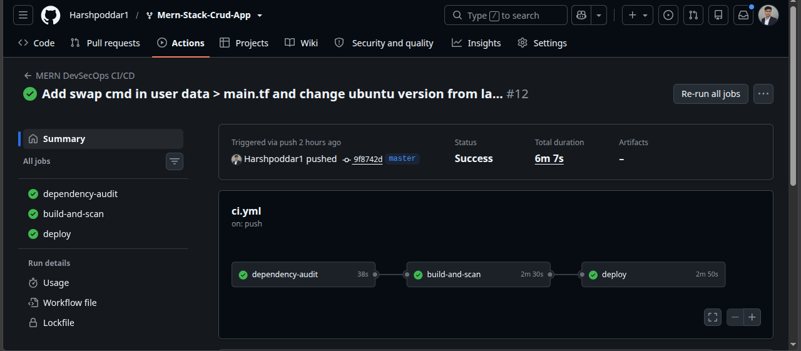
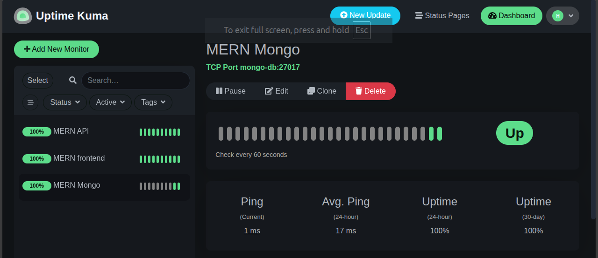
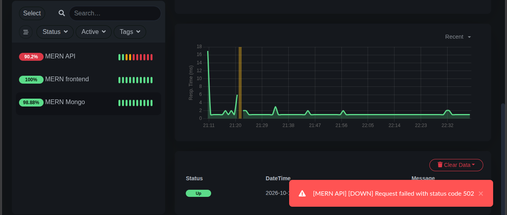

# MERN CRUD App: DevSecOps Deployment

A MERN (MongoDB, Express, React, Node) student CRUD app, containerized and deployed to AWS EC2 through a secured CI/CD pipeline, with infrastructure as code and uptime monitoring.

> **Credit:** the application code is from [harounchebbi/Mern-Stack-Crud-App](https://github.com/harounchebbi/Mern-Stack-Crud-App). I forked it and built the DevOps and DevSecOps layer around it: Docker, Compose, secrets handling, security scanning, CI/CD, Terraform and monitoring.

## Architecture

```
Browser
   |  :80
   v
nginx (client container)  --serves-->  React static build
   |  /api/ (reverse proxy)
   v
Express backend (:5000, internal only)
   |
   v
MongoDB 7.0 (:27017, internal only)

Uptime Kuma (:3001, restricted to my IP) monitors the three layers above
```

Only ports 22 (SSH) and 80 (HTTP) are open to the internet. The backend and MongoDB are reachable only inside the Docker network.

## What I built

| Area | Details |
|---|---|
| Docker | Backend: `node:24-alpine`, `npm ci --omit=dev`, npm removed from the final image. Client: multi-stage build (`node:16-alpine` builder, `nginx:alpine` final) with a custom `nginx.conf` |
| Compose | 4 services (backend, client, MongoDB, Uptime Kuma), named volumes for MongoDB and Kuma data |
| Secrets | `MONGO_URI` is read from an environment variable. Locally from `.env` (git-ignored), in deployment from a GitHub Actions secret |
| CI/CD | GitHub Actions, 3 jobs: `dependency-audit` -> `build-and-scan` -> `deploy` |
| IaC | Terraform: EC2 `t3.micro`, security group, 20 GB root volume, `user_data` that installs Docker and adds 1 GB swap |
| Monitoring | Uptime Kuma with 3 monitors: frontend (HTTP), API (HTTP on `/api/students`), MongoDB (TCP) |

## CI/CD pipeline

Triggered on every push to `master`. A later job runs only if the earlier one passes.

1. **dependency-audit**
   - `npm ci`, then `npm audit --omit=dev --audit-level=high` on the backend. Fails on high or critical findings.
   - Client audit runs in warn-only mode (`continue-on-error`). See Known limitations.
2. **build-and-scan**
   - Builds both images, then scans each with Trivy twice:
     - *visibility* scan: reports all HIGH and CRITICAL findings, never fails
     - *gate* scan: `ignore-unfixed: true`, fails the pipeline only if a fix exists
   - `trivy-action` is pinned to `v0.36.0`.
3. **deploy**
   - SSH to the server with `appleboy/ssh-action` (pinned `v1.2.5`, `script_stop: true`), clones or pulls the repo, writes `.env` from the `MONGO_URI` secret, runs `docker compose up --build -d`.



## Monitoring

Uptime Kuma runs as a service in the same Compose file and watches each layer separately: frontend (HTTP), API (HTTP on `/api/students`) and MongoDB (TCP on `mongo-db:27017`).



Failure test: after stopping the backend container, the API monitor goes down with a 502 from nginx while the frontend monitor stays up. This is why one frontend check alone is not enough.



## Security decisions

- Actions are pinned to versions, not `@latest` or `@master`, because the SSH action receives the private key and the scanner is part of the trust chain.
- The backend image contains no dev dependencies and no npm. The dev-only `nodemon` chain and npm's bundled packages were the source of the Trivy findings.
- Backend (5000) and MongoDB (27017) are never published to the host. Kuma (3001) is open only to my own IP (`/32`).
- Secrets are never committed. `.env` and Terraform state are git-ignored.

## Run locally

```bash
echo "MONGO_URI=mongodb://mongo-db:27017/db_test" > .env
docker compose up --build
```

App: `http://localhost` (client on port 80). Kuma: `http://localhost:3001`.

## Deploy to AWS

```bash
cd terraform
terraform init
terraform apply
terraform output server_ip
```

Add these GitHub Actions secrets, then push to `master`:

- `EC2_HOST` (the IP from the output)
- `EC2_USER` (`ubuntu`)
- `EC2_SSH_KEY` (full private key content)
- `MONGO_URI`

Run `terraform destroy` when done to avoid charges. The server IP changes on every `apply`, so update `EC2_HOST` each time.

## Problems I debugged

- **Mongoose upgrade:** fixing a critical NoSQL injection finding broke the app (removed connection options, and `findByIdAndRemove` no longer exists, replaced with `findByIdAndDelete`).
- **Peer dependency conflict:** the client needs `npm ci --legacy-peer-deps` (`react-spinners` expects React 16, the app uses 17).
- **Outbound timeouts on the server:** caused by a security group egress rule restricted to one IP. Ingress was fine, so SSH still worked while `git pull` and image pulls failed.
- **`no space left on device`:** the default 8 GB root disk filled up. Fixed with build cache cleanup, a 20 GB volume in Terraform, then `growpart` and `resize2fs` on the live server.
- **502 vs timeout:** stopping the backend gave a 502 on the API monitor while the frontend monitor stayed green. nginx was alive, the service behind it was not.

## Known limitations

- The client has about 200 `npm audit` findings, mostly in the Create React App build toolchain. They are accepted because the final client image contains only the compiled `build/` folder served by nginx, and the findings are not gated.
- MongoDB runs without authentication. It is reachable only inside the Docker network.
- No HTTPS, and a single instance.
- Port 22 is open to `0.0.0.0/0` because GitHub-hosted runner IPs change. Protection relies on SSH key authentication only.
- Kuma runs on the server it monitors, so if the server goes down, no alert is sent.
